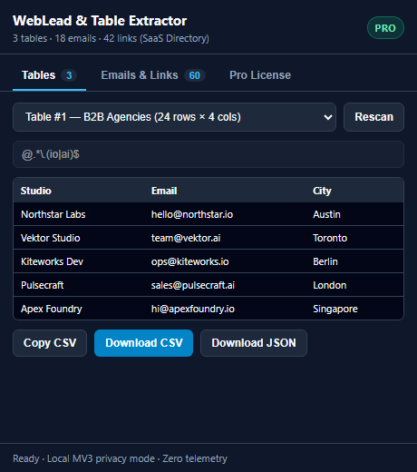

# WebLead & Table Extractor (Chrome MV3)

**Zero-dependency Manifest V3 Chrome extension to extract live HTML tables, public business emails, phone leads, and outbound links cleanly into RFC 4180 CSV or JSON.**



---

## Key Features

- **Smart HTML Table Extraction**: Reads live `<table>` elements, expands horizontal `colspan` (and `rowspan`) headers/cells cleanly, normalizes whitespace, and exports rectangular tables ready for Excel, Google Sheets, or Python/pandas.
- **Public Contact & Link Scanner**: Deduplicates `mailto:` and plain-text public email addresses (filtering out retina asset filenames like `logo@2x.png` or `sprite@3x.svg`), extracts phone candidates, and classifies social vs website links.
- **Strict RFC 4180 CSV & UTF-8 BOM**: Properly escapes double quotes (`""`), commas, and multiline cells with optional UTF-8 BOM so spreadsheets open international characters without encoding corruption.
- **Privacy-First Minimal Permissions**: Uses only `activeTab` and on-demand `scripting` on click. No remote servers, no analytics, no persistent background scripts, and zero DOM mutation.

---

## Community Free vs Pro Edition

| Feature | Community Free (MIT) | Pro Edition ($15 Lifetime) |
| --- | :---: | :---: |
| HTML Table Extraction & `colspan` Normalization | Full support | Full support |
| Public Email, Phone & Social Link Extraction | Full support | Full support |
| Strict RFC 4180 CSV (UTF-8 BOM) & JSON Export | Up to 25 rows/table | **Unlimited rows** |
| Live Regex Row Filtering | — | **Unlocked** |
| Offline Key Activation (`FS-PRO-WL-...` / `FS-PRO-BUNDLE-...`) | — | **Instant offline verification** |

**[Upgrade to WebLead Extractor Pro ($15 Lifetime) ->](https://youthmy11-ai.github.io/#pricing)**

---

## Load Unpacked in Chrome / Edge / Brave

1. Download or unzip `WebLead-Extractor-MV3-v1.0.zip` into a dedicated folder (make sure `manifest.json` is directly inside that folder).
2. Open `chrome://extensions` in your browser.
3. Enable **Developer mode** (top-right toggle).
4. Click **Load unpacked** and select the extracted folder containing `manifest.json`.
5. Navigate to any webpage with tables or contact listings and click the **WebLead & Table Extractor** toolbar icon.

---

## Running Automated Tests

Requires Node.js 18+:

```bash
node --test tests/test_extractor.mjs
```

---

## What's New (ARIA Grids, Schema.org JSON-LD & Markdown Export)

- Automatically scans standard HTML `<table>` elements, modern ARIA `[role="table"]` / `[role="grid"]` components, and embedded `<script type="application/ld+json">` Schema.org entities (`Organization`, `LocalBusiness`, `@graph`).
- Export any detected table directly as **GFM Markdown (`Copy MD`)**, **RFC 4180 CSV** (with UTF-8 BOM option), or **JSON**.

---

## Companion Tools in ForgeSuite Studio

- **[TokenCost Lab (Free Web App)](https://youthmy11-ai.github.io/tokencalc.html)** — Client-side LLM token counter & AI agent API cost planner.
- **[JSON2Sheet & PII Masker (Free Web App)](https://youthmy11-ai.github.io/json2sheet.html)** — Flatten nested JSON payloads into clean CSV/Markdown tables with PII redaction.
- **[ScopeGuard SOW Builder (Free Web App)](https://youthmy11-ai.github.io/sowbuilder.html)** — Draft milestone escrow Statements of Work with 1-click CryptoBill USDT invoicing.
- **[Calldata Lens (Free Web App)](https://youthmy11-ai.github.io/txdecode.html)** — Offline EVM ABI calldata decoder & `MAX_UINT256` approval risk inspector.
- **[EnvShield Secret Scanner (Free Web App)](https://youthmy11-ai.github.io/envshield.html)** — Offline `.env`, API key & private key leak scanner and safe redactor.
- **[CryptoBill Forge (Free Web App)](https://youthmy11-ai.github.io/cryptobill.html)** — Serverless USDT (BEP20/TRC20) & PayPal invoice studio.
- **[All-Access Pro Bundle ($35 · Save $14)](https://youthmy11-ai.github.io/#pricing)** — Lifetime unlock across WebLead Extractor Pro ($15), AutoShorts Studio Pro ($19), and CryptoBill Forge Pro ($15).

---

## License

Released under the [MIT License](LICENSE).
